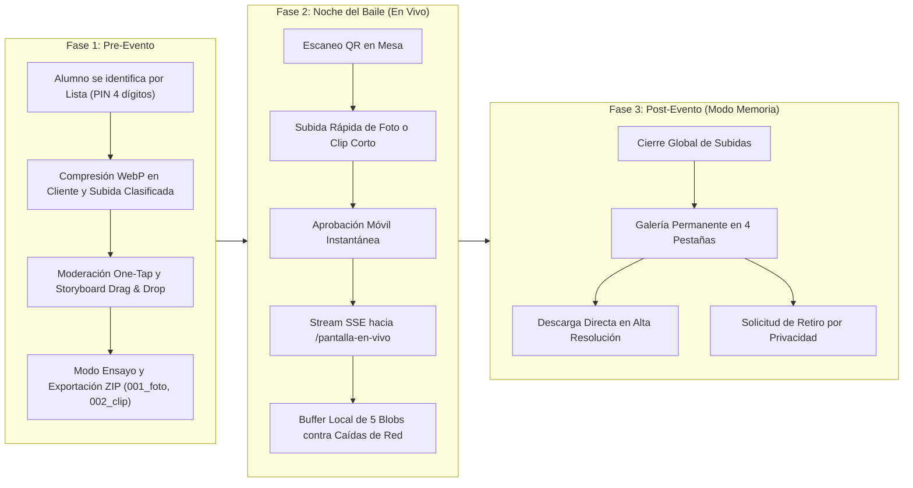

# Arquitectura del Sistema — Plataforma Integral de Baile de Graduación

## 1. Visión General de las 3 Fases Operativas

---

## 2. Flujo de Autenticación sin Matrículas (Padrón Oficial)

1. **Precarga de Invitados**: La tabla `User` almacena `nombre_completo`, `nombre_normalizado` (sin acentos y en minúsculas), `distintivo_homonimo` (carrera/grupo para desambiguar homónimos) y `pin_hash` (`NULL` inicialmente).
2. **Typeahead Predictivo**: El endpoint `GET /api/auth/search?q=` normaliza la entrada del alumno con `String.prototype.normalize('NFD')` y filtra coincidencias instantáneas.
3. **Activación en Primer Ingreso**: Si `pin_hash` es `NULL`, el sistema solicita crear un PIN numérico de 4 dígitos, lo deriva con `crypto.scryptSync` + sal aleatoria y devuelve un JWT con vigencia de 30 días almacenado en `localStorage`.
4. **Recuperación en 1 Clic**: Desde el Panel de Administradoras, `POST /api/admin/users/:id/reset-pin` limpia `pin_hash = NULL` para permitir que el alumno registre un nuevo PIN de inmediato.

---

## 3. Estrategia de Buffer Local Resiliente en `/pantalla-en-vivo`

Durante un evento masivo en salón, la red Wi-Fi suele experimentar saturación cuando cientos de invitados suben contenido simultáneamente:
- El componente `LiveWallScreen` mantiene una caché de metadatos en `localStorage` (`gala_livewall_offline_cache_v1`) y un mapa en memoria RAM (`Map<string, string>`) con `URL.createObjectURL(blob)` de los próximos **5 elementos adelantados**.
- Si ocurre una desconexión total de internet o caída momentánea del router, el carrusel continúa reproduciendo las imágenes y videos desde la memoria local del navegador conectado al proyector HDMI sin mostrar pantallas negras ni errores de carga.

